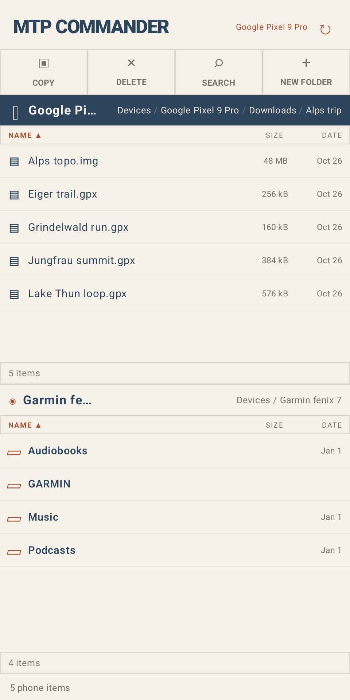
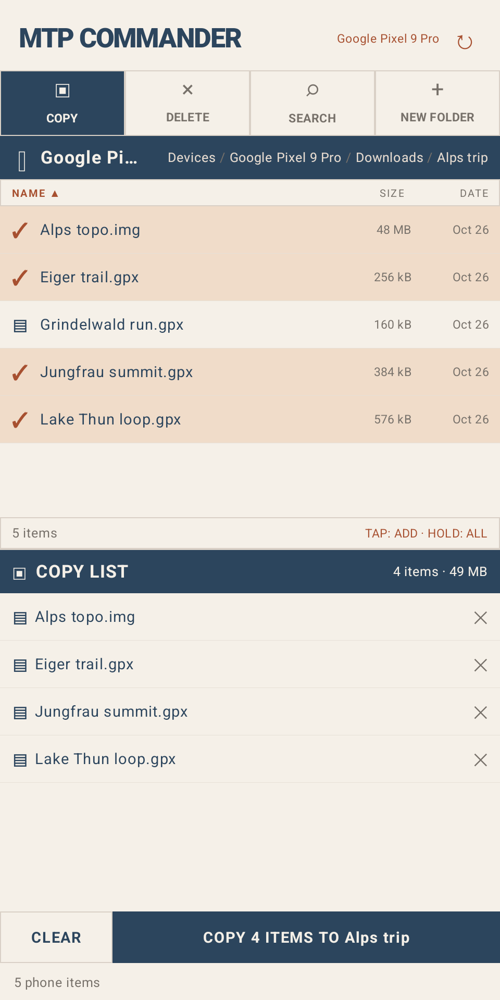
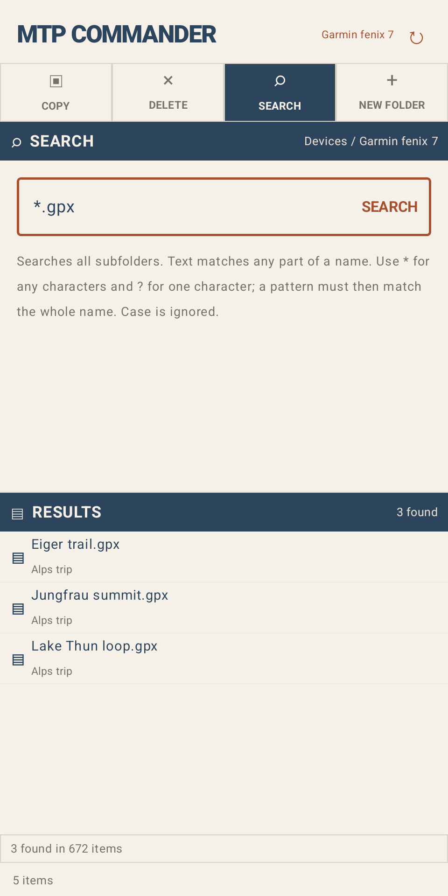

# MTP Commander

A two-pane Android file manager for copying files between your phone, devices plugged in over USB (Garmin watches,
cameras, USB drives) and your own Google Drive.

Website and user guide: https://buessow.github.io/mtp_commander/ ·
[Privacy policy](https://buessow.github.io/mtp_commander/privacy)

<p>
  
  
  
</p>

## Using it

1. Plug a device into the phone's USB port (USB-C or an OTG adapter) and open MTP Commander.
2. Each pane starts on **Devices**. Tap the phone, a USB device, a USB drive or Google Drive to open it.
   - A USB device asks for USB access the first time.
   - A USB drive, or a camera in mass storage mode, appears as **USB drive · tap to allow access**. Tap it and press
     **Use this folder** in Android's folder picker; the grant is remembered.
   - Google Drive asks you to pick an account. The app only sees files and folders it created itself.
3. Tap a pane's header to select it. The selected pane has the dark header.
4. **COPY** turns the other pane into a copy list. Tap files in the selected pane to add them (hold to add the whole
   folder), then press **COPY n ITEMS** to copy them into the folder the other pane was showing. The app asks before
   overwriting.
5. **DELETE** works the same way with a trash list. Nothing is deleted until you press **DELETE n ITEMS**; Google
   Drive files go to Drive's trash.
6. **SEARCH** finds files in every subfolder of the selected pane's folder. Plain text matches any part of a name;
   `*` and `?` are wildcards, e.g. `*.fit`.
7. **NEW FOLDER** creates a folder in the selected pane's folder.
8. Tap a column header (Name, Size, Date) to sort by it.

## Local development

### Requirements

- Android Studio, or JDK 21 and the Android SDK with platform 37
- A phone with Android 10 or later and USB host (OTG) support. The emulator can't attach USB devices.
- A Google Cloud project for the Google Drive pane (see below)

### Build and run

```sh
./gradlew installDebug       # build and install on the connected phone
./gradlew assembleDebug      # just build: app/build/outputs/apk/debug/app-debug.apk
./gradlew test               # unit tests
```

The phone's USB port is needed for the device you're testing with, so connect the phone to adb over
[wireless debugging](https://developer.android.com/tools/adb#connect-to-a-device-over-wi-fi) and follow the app's log
with `adb logcat -s AndroidMTP`.

### Google Drive setup

The Drive pane needs a Google Cloud project that knows your debug signing key. Without it, everything else works and
the Drive pane shows an authorization error. The app has no client ID in its code: Google Play services finds the
OAuth client by package name and the SHA-1 of the signing key.

1. Get the SHA-1 of your debug key:
   ```sh
   keytool -list -v -keystore ~/.android/debug.keystore -storepass android | grep SHA1
   ```
2. In the [Google Cloud console](https://console.cloud.google.com), create or pick a project and enable the
   **Google Drive API** under *APIs & Services → Library*.
3. In [Google Auth Platform](https://console.cloud.google.com/auth/overview), set up the consent screen with audience
   **External**, add the scope `https://www.googleapis.com/auth/drive.file` under *Data Access*, and add your Google
   account as a test user under *Audience*.
4. Under *Clients*, create a client of type **Android** with package name `cc.buessow.mtpcommander` and the SHA-1
   from step 1.

A new client can take a few minutes to start working.

## Releases

Push to the `production` branch. The [release workflow](.github/workflows/release.yml) builds a signed APK and AAB and
attaches them to a GitHub release.

The Play Store listing is in [`fastlane/metadata/android`](fastlane/metadata/android); the website and privacy policy are
in [`docs/`](docs).

## License

The code is licensed under the [Apache License 2.0](LICENSE). The name "MTP Commander" and the app icon are not: if
you publish a modified version, give it your own name and icon. See [`NOTICE`](NOTICE).
